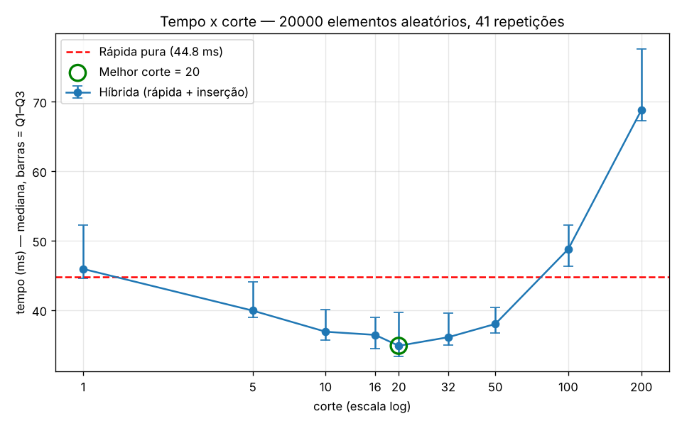

# Ordenação híbrida: rápida + inserção

Implementação da ordenação rápida (quicksort) com pivô aleatório e de uma versão híbrida que troca para a ordenação por inserção quando o pedaço fica pequeno. O objetivo é descobrir qual o melhor ponto de troca (`corte`).

## Arquivos

| arquivo | o que faz |
|---|---|
| `ordenacao.py` | `quicksort(v)`, `quicksort_hibrido(v, corte)` e `insercao(v)` |
| `medir.py` | mede o tempo com 20 000 elementos aleatórios para a rápida pura e para os cortes 1, 5, 10, 16, 20, 32, 50, 100 e 200, imprime a tabela e gera `grafico_corte.png` |
| `verifica_corte1.py` | confirma que `corte = 1` faz exatamente as mesmas chamadas que a rápida pura |
| `RELATORIO.md` | tabela, gráfico e análise dos resultados |
| `grafico_corte.png` | gráfico do tempo em função do corte |

## Como rodar

Requer Python 3 e matplotlib:

```bash
pip install matplotlib
python3 medir.py            # tabela no terminal + grafico_corte.png
python3 verifica_corte1.py  # verificação do corte = 1
```

A medição leva cerca de 1 minuto (41 repetições × 10 variantes).

## Como funciona

- **Rápida pura:** sorteia um pivô e separa a lista em **menores**, **iguais** e **maiores**. Depois ordena recursivamente só os menores e os maiores.
- **Híbrida:** igual à pura, mas se `len(v) < corte` ordena o pedaço por inserção em vez de continuar a recursão.

```python
from ordenacao import quicksort, quicksort_hibrido

quicksort([5, 3, 8, 1])                     # [1, 3, 5, 8]
quicksort_hibrido([5, 3, 8, 1], corte=20)   # [1, 3, 5, 8]
```

## Resultado principal

| | tempo (mediana) |
|---|---:|
| rápida pura | 44,8 ms |
| melhor híbrida (corte = 20) | 34,9 ms (**~22% mais rápida**) |

- Os cortes de 10 a 50 ficam todos entre 15% e 22% mais rápidos que a pura.
- Com cortes de 100 ou mais, a híbrida fica mais lenta que a pura, porque a inserção, que é quadrática, passa a ordenar pedaços grandes.
- `corte = 1` é igual à rápida pura.



Os tempos absolutos variam de máquina para máquina; o formato da curva se mantém. A análise completa e a metodologia de medição estão no [RELATORIO.md](RELATORIO.md).
